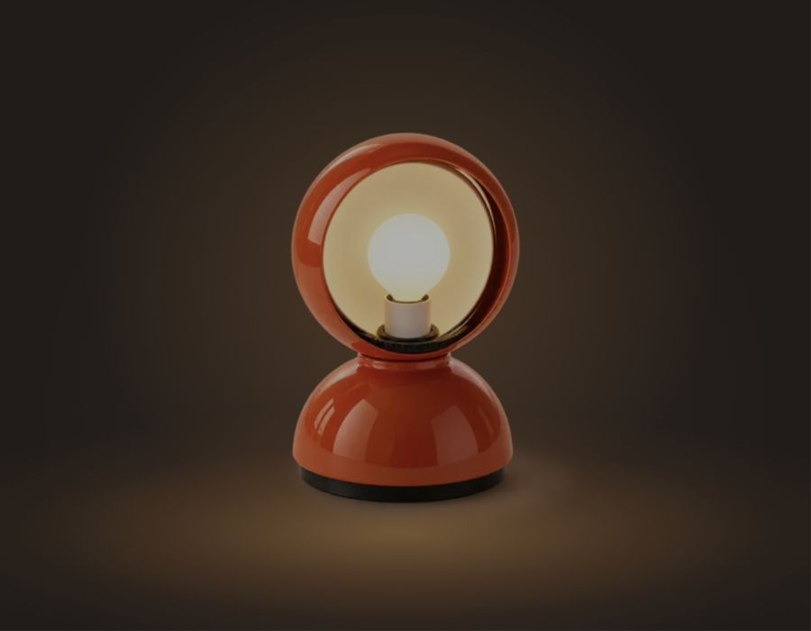
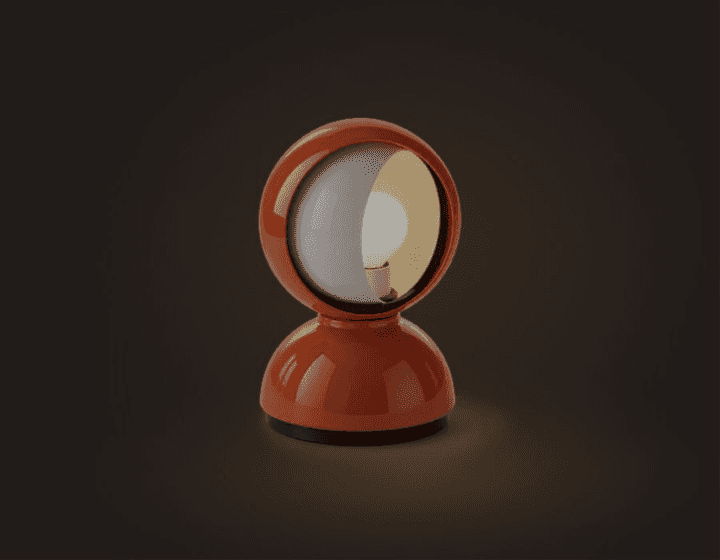

# Eclisse — a study of light

An interactive lamp study by [Helen Shim](https://helenshim.me), inspired by the Eclisse lamp designed by Vico Magistretti for Artemide.

**[Try the live demo →](https://helenshim.me/eclisse)**



Drag the round shade horizontally, or scroll sideways over it, to reveal and conceal the bulb. The surrounding glow brightens, dims, and shifts toward the uncovered side of the opening. The detailed lamp body stays fixed throughout.

Built with **GPT-6.1 Sol and GPT-6 Astra**. Shipped October 11, 2026.

## Interaction



- Drag in either direction through any number of turns; release holds the selected position.
- Horizontal trackpad scrolling and Shift + mouse wheel also rotate the shade.
- Arrow keys rotate by 9°; Home closes the shade and End opens it.
- Reduced-motion settings remove smoothing. Rendering stops at rest and while the tab is hidden.

## Design and implementation

The page is a quiet product study with no visible text or controls. The original image remains on screen at a fixed size, preserving its enamel reflections, silhouette, and mounting details.

A Canvas 2D layer composites photographic open/closed interior plates inside the circular opening. A curved mask changes with the rotation angle. The uncovered area controls surrounding light intensity, while its centroid steers the ambient glow and floor spill. This is an image-based illusion of rotation and lighting, rather than a volumetric or photometric simulation.

The implementation uses Next.js, React, TypeScript, Canvas 2D, and CSS. No Three.js or WebGL dependency is required in this version.

The models helped implement and iterate on the interface. The lamp imagery and interior plates were generated/edited with OpenAI image generation and are illustrative, not official product photography. The physical lamp design belongs to its respective creators; this independent study is not affiliated with Artemide.

## Run locally

Requires Node.js 24 or newer. No API keys, environment variables, or external services are required.

```sh
npm ci
npm run build
npm start
```

Open http://localhost:3000. This standalone repository serves the lamp at `/`; its public live version is hosted at `/eclisse` on Helen’s portfolio.

```sh
npm run lint
npm run check
```

## Source

- `app/LampScene.tsx` — image, accessible slider, and renderer lifecycle.
- `app/lamp-renderer.ts` — masks, continuous rotation, input handling, and light spill.
- `app/eclisse.module.css` — composition and dynamic surrounding light.
- `public/eclisse/` — original still and interior plates.

This repository was extracted from the shipped portfolio project for focused exploration. The live site remains deployed from [helen-portfolio](https://github.com/helenhshim/helen-portfolio). Its source history includes the [initial lamp release](https://github.com/helenhshim/helen-portfolio/pull/1), [photographic interaction and lighting](https://github.com/helenhshim/helen-portfolio/pull/2), and [homepage entry point](https://github.com/helenhshim/helen-portfolio/pull/3). These links may require access if the portfolio repository is private.

## Reuse

No open-source license is granted at this time. Contact Helen for permission to reuse the code or image assets.
